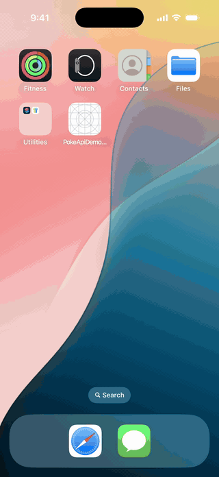
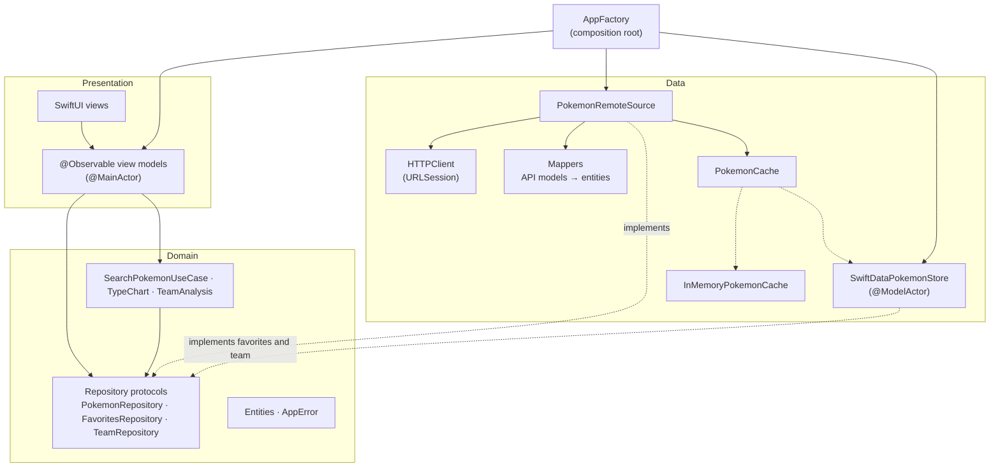

# Pokédex: SwiftUI, Clean Architecture, Swift 6

A SwiftUI Pokédex built on [PokéAPI](https://pokeapi.co). It works offline with SwiftData, analyzes a team's type matchups, shows evolution chains, and is covered by unit and UI tests in Swift 6 strict-concurrency mode.

<p align="center">
  
</p>

## Features

- **Infinite scroll** over the full Pokédex. Each page's details load in parallel.
- **Search and filter.** A debounced search by name or number, and a filter by type.
- **Offline mode.** Viewed Pokémon, the search index, type lists and evolution chains are saved with SwiftData. The app opens and browses in airplane mode.
- **Favorites**, saved on the device.
- **Team builder.** Pick up to six Pokémon to see:
  - the team's shared weaknesses, resistances and immunities for every attacking type;
  - which types the team's own types hit super-effectively.
- **Evolution chains**, including branches such as Eevee's and how each stage evolves (level, item, trade, friendship). Tapping a stage moves the highlight to it and opens it.
- **Polish.** Cards zoom into the detail screen on iOS 18 and later, with a standard push on iOS 17. Haptics play on taps only, and every type color is readable in light and dark mode.

## Architecture



- **Domain** is plain Swift with no framework imports beyond Foundation. The team analysis, type chart and search filtering are pure functions, unit-tested directly.
- **Data** turns PokéAPI responses into domain entities and decides when to use the network and when to use the store.
- **Presentation** holds `@Observable` view models that receive their dependencies as protocols, so tests swap in stubs.
- **`AppFactory`** is the only place that creates concrete types.

## Technical decisions

**Each page's details load in parallel with a `TaskGroup`.** The list endpoint returns only names and URLs, so each card needs its own detail request. `fetchPokemons(ids:)` starts them in a throwing `TaskGroup` and puts the results back in the original order. A page appears in about the time of its slowest request, rather than the sum of all of them.

**Search requests run concurrently with `async let`.** The name index and a type's member list are independent requests, so they are fetched at the same time and then filtered locally.

**SwiftData runs behind a `@ModelActor`.** All persistence goes through one actor, `SwiftDataPokemonStore`, so the model context never crosses threads, and Swift 6 checks this at compile time. Records use `@Attribute(.unique)` keys and are upserted, so saving a Pokémon again keeps its favorite and team flags.

**Caching and offline mode use the store first, then the network:**
- Details, the search index, type lists and evolution chains are read from the store first and saved after every successful fetch.
- When the network fails, the list falls back to the saved pages and shows an offline banner.
- Evolution chains are saved as one JSON payload, plus an index from each species to its chain. Opening Ivysaur after Bulbasaur therefore needs no request.

**Repositories return `Result<_, AppError>` instead of throwing.** Every failure is a typed, user-presentable error with a friendly message. View models switch over the result exhaustively.

**Swift 6 language mode with strict concurrency.** View models are `@MainActor`, the data layer is `Sendable`, and the store is an actor. The project builds with no warnings.

**Zoom transitions on iOS 18, push on iOS 17.** `matchedTransitionSource` and `.navigationTransition(.zoom)` sit behind `#available` in two small modifiers, so the deployment target stays at iOS 17.6. Navigation destinations are registered once per stack, in a shared `.pokemonDestinations(zoom:)` modifier.

**Mocks are kept out of release builds.** The fixture repositories live in `Preview Content/Mocks` and are wrapped in `#if DEBUG`, as are the previews that use them.

## Testing

| Layer | Approach |
| --- | --- |
| Domain logic | Swift Testing with parameterized cases: type chart, team analysis, search filtering |
| View models | Swift Testing with stub repositories (`TestSupport.swift`), covering loading, paging, errors, cancellation and retries |
| Data | Mappers, the remote source over a stub `HTTPClient`, the SwiftData store in memory |
| HTTP | The real `URLSession` stack with a stub `URLProtocol` (`URLSessionHTTPClientTests`): status codes, decoding, offline |
| UI | XCUITest: list → detail → evolution, run against bundled fixtures with no network (`-ui-testing`) |

```sh
xcodebuild test -project "Poke Api Demo.xcodeproj" -scheme "Poke Api Demo" \
  -destination 'platform=iOS Simulator,name=iPhone 17 Pro'
```

The GIF above is recorded by `DemoTourUITests`, which uses live data and is skipped unless `TEST_RUNNER_DEMO_TOUR=1` is set.

## Getting started

- **Requirements:** Xcode 26 and iOS 17.6 or later. The only dependency is [SDWebImageSwiftUI](https://github.com/SDWebImage/SDWebImageSwiftUI), resolved by Swift Package Manager.
- **Run:** open `Poke Api Demo.xcodeproj` and run the **Poke Api Demo** scheme.
- **Lint and format:** the project uses Apple's [swift-format](https://github.com/swiftlang/swift-format), which ships with Xcode, so there's nothing to install. The rules are in `.swift-format`.

  ```sh
  scripts/lint.sh     # fails on any finding
  scripts/format.sh   # formats in place
  ```
- **CI:** a GitHub Actions workflow is in `ci/ios-ci.yml.example`. It lints, runs the unit and UI tests, and builds Release on `macos-26`. It is kept outside `.github/` so it doesn't run. To enable it:

  ```sh
  mkdir -p .github/workflows && git mv ci/ios-ci.yml.example .github/workflows/ci.yml
  ```

## Disclaimer

Data and artwork come from [PokéAPI](https://pokeapi.co). Pokémon and Pokémon character names are trademarks of Nintendo, Game Freak and Creatures Inc. This is a non-commercial portfolio project, not affiliated with them and not distributed on the App Store.
